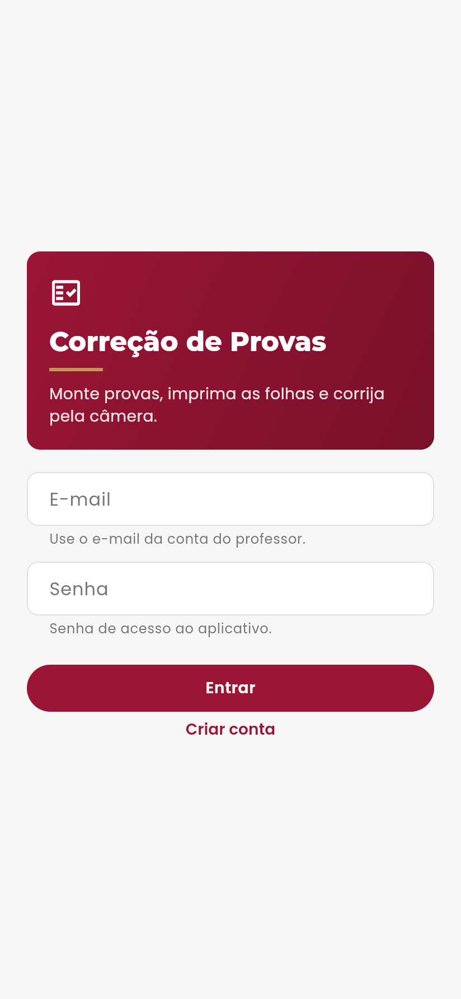
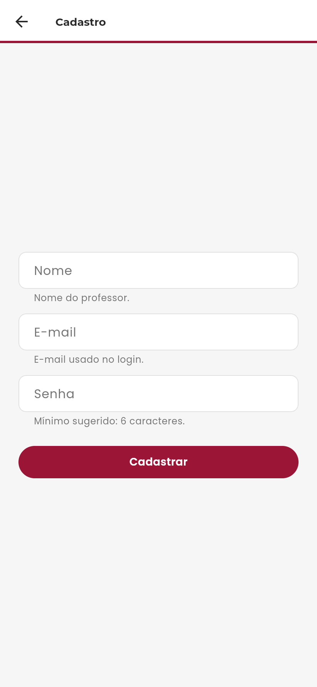
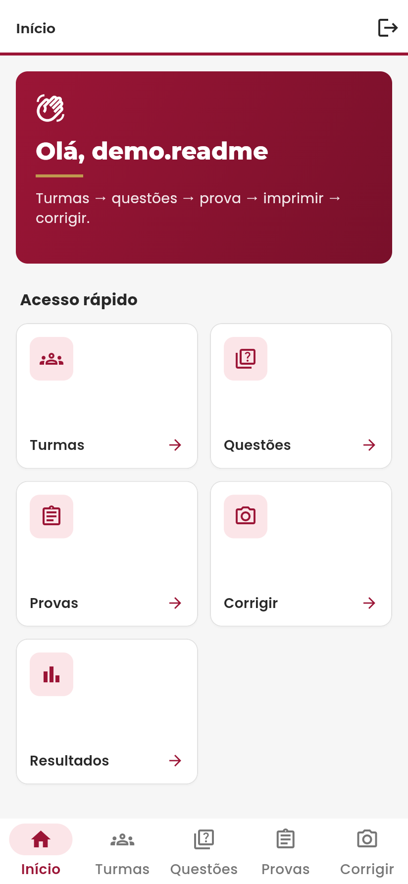
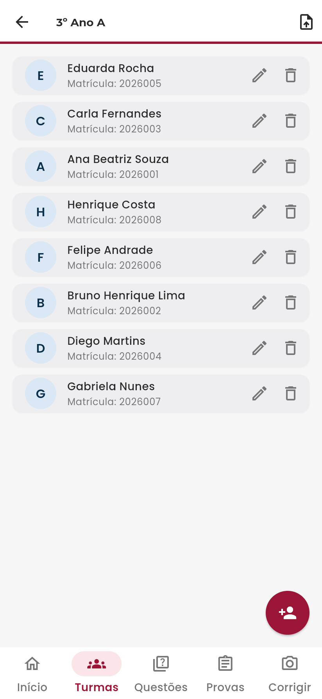
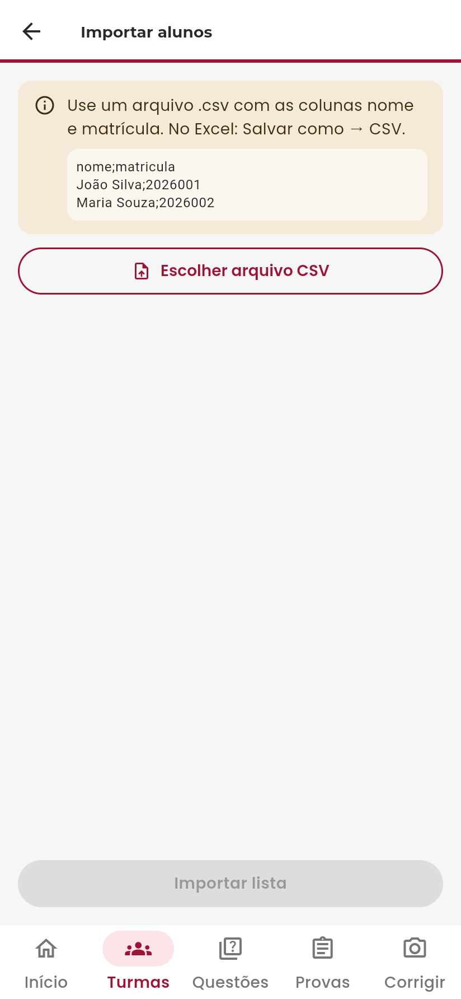
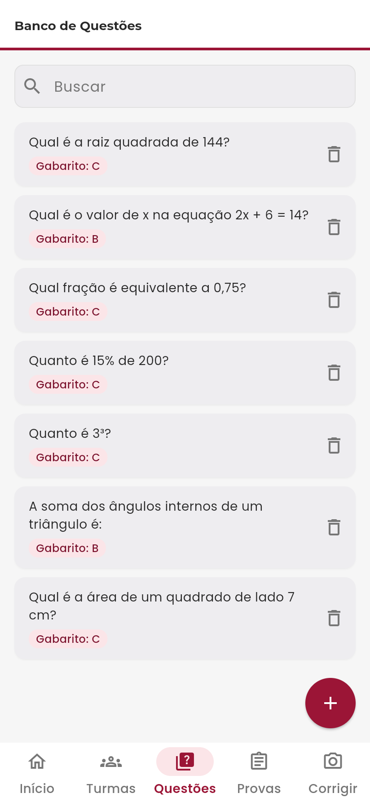
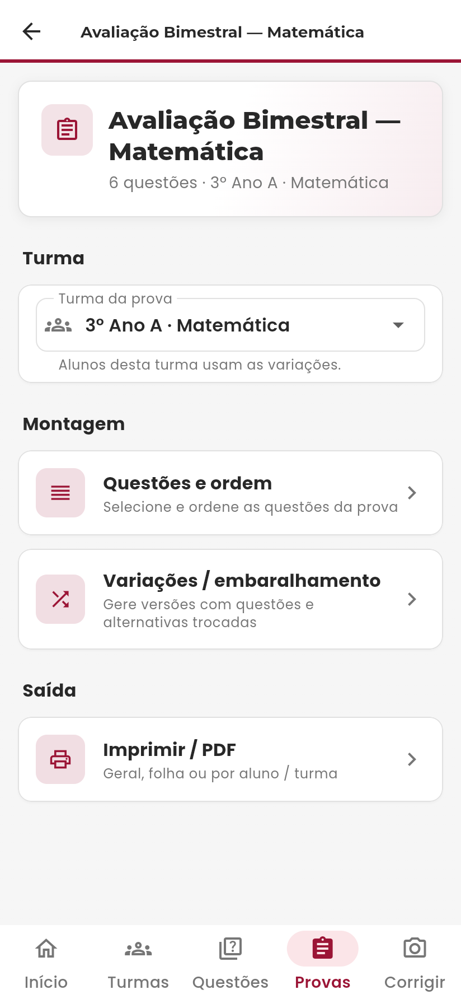
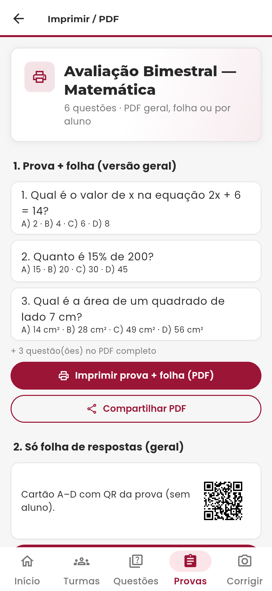
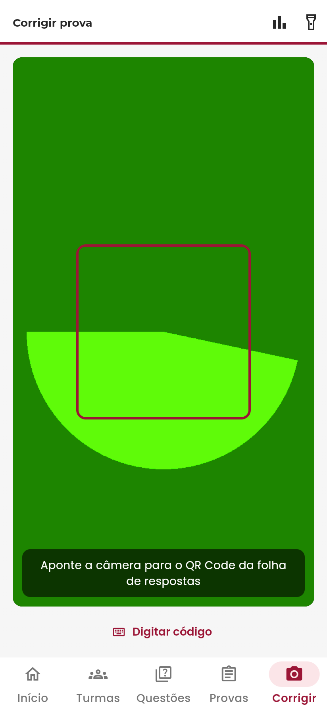
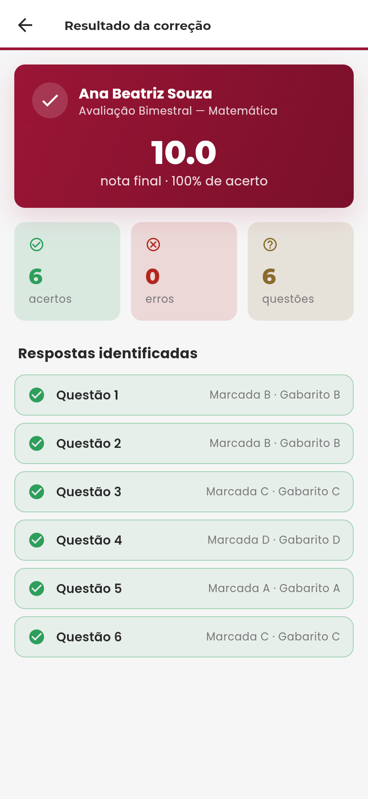

<div align="center">

# 📝 App de Correção Automática de Provas

**App para professores montarem provas de múltipla escolha, imprimirem folhas de resposta com QR Code e corrigirem pela câmera do celular.**


</div>

## 👥 Equipe

| Nome completo |
|---|
| Ana Paula Lenckulh |
| Karoliny Daiana Cieply |
| Letícia Waismann |
| Mirella Melo |
| Vítor Uler |

## 📑 Sumário

- [1. Visão Geral](#1-visão-geral)
- [2. Requisitos](#2-requisitos)
  - [2.1 Funcionais (RF)](#21-funcionais-rf)
  - [2.2 Não Funcionais (RNF)](#22-não-funcionais-rnf)
  - [2.3 Limites e restrições](#23-limites-e-restrições)
- [3. Telas do Sistema](#3-telas-do-sistema)
- [4. Modelo de Dados](#4-modelo-de-dados)
- [5. Stack Tecnológica](#5-stack-tecnológica)
- [6. Estrutura de Pastas](#6-estrutura-de-pastas)
- [7. Como Executar o Projeto](#7-como-executar-o-projeto)
- [8. Backlog de Atividades da N2](#8-backlog-de-atividades-da-n2)

---

## 1. Visão Geral

📌 **N1**

Corrigir provas de múltipla escolha à mão toma muito tempo do professor: conferir folha por folha, somar acertos e passar as notas para o sistema acadêmico. Este app atende o **professor**: ele cadastra turmas e alunos, monta um banco de questões, gera provas com questões e alternativas embaralhadas por aluno, imprime as folhas de resposta com um QR Code individual e corrige apontando a câmera do celular para a folha. A nota sai na hora e fica salva para consulta e estatísticas da turma.

**Escopo por entrega**

- **N1 — protótipo navegável (entregue):** fluxo completo com dados mock: Login → Turmas/Alunos → Questões → Provas → Variações → Folha/QR → Correção simulada → Resultados.
- **N2 — sistema funcional (atual):** dados mock substituídos por **Firebase Authentication + Firebase Realtime Database**. Cadastro, listagem, edição e exclusão reais de turmas, alunos, questões e provas; importação de alunos por CSV; variações embaralhadas persistidas; PDF da prova e da folha com QR; leitura do QR pela câmera; correção (respostas A–D informadas após ler o QR), resultados e estatísticas reais.
- **N3 — planejado:** leitura óptica das marcações da folha (OMR), exportação para Excel, regras de segurança por professor, testes automatizados e layout de impressão validado.

> **Banco de dados:** a disciplina sugere o Firestore, mas a equipe usou o **Realtime Database** (também do Firebase). Os repositórios do app (`*RtdbRepository`) já estavam modelados como árvore JSON, e o RTDB atende o CRUD de todas as telas. A justificativa está nos diários de bordo.

**Fluxo principal:** Turma + alunos → banco de questões → prova (questões + turma) → variações por aluno → imprimir PDF com QR → **Corrigir** (lê o QR e recebe as respostas) → **Resultados**.

**Regras importantes**

- Cada folha (aluno + prova) tem uma única correção; corrigir de novo substitui a nota.
- Gerar de novo a variação de um aluno, ou mudar as questões ou a turma da prova, invalida as folhas já impressas (o app pede confirmação).
- A correção usa o gabarito atual da questão e o salva junto com a nota.
- Questão usada em alguma prova não pode ser excluída.

📹 [Vídeo demonstrativo do sistema](https://www.youtube.com/watch?v=Y0RQv2h-qpc)

## 2. Requisitos

📌 **N1** (ajustados na N2 com a coluna de status)

### 2.1 Funcionais (RF)

**Banco de questões e elaboração de provas**

| Código | Requisito | Status N2 |
|---|---|---|
| RF01 | **Cadastrar banco de questões:** o sistema deve permitir que o professor cadastre e armazene questões com suas alternativas e a indicação da resposta correta. | ✅ Implementado |
| RF02 | **Emissão em formato editável:** o sistema deve gerar as provas em formato editável (ex.: .doc), permitindo ao professor ajustar o layout para que enunciados e alternativas não fiquem cortados entre páginas. | 🟡 Parcial (gera PDF) |
| RF03 | **Embaralhamento de questões e alternativas:** o sistema deve permitir gerar provas embaralhando a ordem das questões e das alternativas. | ✅ Implementado |
| RF04 | **Provas gerais e individualizadas:** o sistema deve gerar modelos de prova iguais para a turma ou exames individualizados (com nome do aluno e folha de resposta associada). | ✅ Implementado |

**Gestão de alunos, turmas e correção**

| Código | Requisito | Status N2 |
|---|---|---|
| RF05 | **Folha de respostas com QR Code:** o sistema deve gerar a folha de respostas com um QR Code que vincula a folha à prova e ao aluno. | ✅ Implementado |
| RF06 | **Leitura e correção pela câmera:** o sistema deve usar a câmera do celular para escanear o QR Code e as marcações da folha de resposta. | 🟡 Parcial (lê o QR; marcações são informadas à mão — OMR na N3) |
| RF07 | **Nota automática e feedback imediato:** o sistema deve calcular a nota automaticamente e mostrar o resultado na hora. | ✅ Implementado |
| RF08 | **Importação de lista de alunos:** o sistema deve permitir importar listas de alunos para as turmas. | ✅ Implementado (CSV) |

**Relatórios e análise estatística**

| Código | Requisito | Status N2 |
|---|---|---|
| RF09 | **Exportação de notas em planilha:** o sistema deve exportar o relatório final de notas em Excel, para facilitar o lançamento no sistema acadêmico. | ⏳ N3 |
| RF10 | **Detalhamento de respostas por aluno:** o relatório deve indicar não só acerto/erro, mas qual alternativa o aluno marcou em cada questão. | ✅ Implementado (na tela de resultado) |
| RF11 | **Análise estatística por questão:** o sistema deve mostrar o percentual de acertos/erros e a alternativa mais marcada pela turma em cada questão. | ✅ Implementado |

**Multiplataforma**

| Código | Requisito | Status N2 |
|---|---|---|
| RF12 | **Acesso Web e Mobile:** o sistema deve oferecer interface Web para cadastro de questões e montagem de provas, e app Mobile para a correção pela câmera. | ✅ Implementado (mesmo app Flutter em Web e Android) |

### 2.2 Não Funcionais (RNF)

| Código | Requisito |
|---|---|
| RNF01 | **Desempenho na correção:** a leitura e correção devem permitir corrigir uma turma de cerca de 50 alunos em aproximadamente 30 minutos. |
| RNF02 | **Usabilidade e interface minimalista:** a interface deve ser simples, lógica e com poucos elementos em tela, priorizando a facilidade de uso durante a correção. |
| RNF03 | **Precisão no processamento de imagem:** a leitura pela câmera deve identificar com alta precisão o QR Code e as marcações da folha. |
| RNF04 | **Portabilidade:** o sistema deve ter interface Web para gestão/criação de provas e app Mobile para captura e correção pela câmera. |
| RNF05 | **Compatibilidade de exportação:** relatórios devem ser exportados em formatos amplamente compatíveis, especificamente Excel (.xlsx) e documentos editáveis (.doc). |
| RNF06 | **Segurança de acesso:** só usuários autenticados pelo Firebase Authentication acessam os dados; a senha nunca é gravada no banco. |

### 2.3 Limites e restrições

- A correção automatizada depende de uma câmera funcional no celular do professor.
- A leitura depende da impressão correta da folha de respostas, com o QR Code e os campos de marcação legíveis.
- O sistema corrige apenas questões de múltipla escolha (4 alternativas, A–D); questões discursivas não são corrigidas automaticamente.

## 3. Telas do Sistema

📌 **N1** (atualizadas na N2)

Prints na ordem em que o professor navega. As imagens ficam em [`docs/telas/`](docs/telas/).


*Login: autenticação do professor por e-mail e senha (Firebase Authentication).*


*Cadastro: cria a conta do professor e o perfil em `professores/{uid}`.*


*Início: resumo de turmas, questões, provas e correções, com atalhos para as próximas ações.*


*Turma: lista de alunos, cadastro manual e importação por CSV.*


*Importação CSV: prévia com validação linha a linha antes de gravar.*


*Banco de questões: busca, enunciado, alternativas A–D e gabarito.*


*Prova: questões selecionadas, turma vinculada e variações por aluno.*


*Imprimir: PDF da prova e da folha de respostas com QR, geral ou por aluno.*


*Corrigir: leitura do QR pela câmera e marcação das respostas A–D.*


*Resultado: nota, acertos e alternativa marcada em cada questão.*


*Estatísticas: percentual de acerto e alternativa mais marcada por questão.*

## 4. Modelo de Dados

📌 **N3** (adiantado na N2)

Os dados ficam no **Firebase Realtime Database**, que guarda tudo como uma árvore JSON: cada "coleção" é um nó na raiz e cada registro é uma chave dentro dele. Abaixo, um exemplo de cada nó (baseado no seed em [`docs/seed/realtime-database-seed.json`](docs/seed/realtime-database-seed.json)) e o dicionário de dados. O diagrama de relacionamentos está em [`docs/BANCO-DE-DADOS.md`](docs/BANCO-DE-DADOS.md).

### `professores`

```json
"professores": {
  "3JvuX2G7QzTn0dGDJtJHn1CwuY92": {
    "nome": "Ana Paula",
    "email": "ana@escola.com"
  }
}
```

| Campo | Tipo | Descrição |
|---|---|---|
| (chave) | String | UID do Firebase Authentication |
| nome | String | Nome do professor |
| email | String | E-mail de login |

### `turmas`

```json
"turmas": {
  "turma-1": {
    "professorId": "3JvuX2G7QzTn0dGDJtJHn1CwuY92",
    "nome": "3º Ano A",
    "disciplina": "Matemática",
    "ano": 2026
  }
}
```

| Campo | Tipo | Descrição |
|---|---|---|
| (chave) | String | Identificador da turma |
| professorId | String | Professor dono da turma |
| nome | String | Nome da turma |
| disciplina | String | Disciplina |
| ano | int | Ano letivo |

### `alunos`

```json
"alunos": {
  "aluno-1": {
    "turmaId": "turma-1",
    "nome": "João Silva",
    "matricula": "2026001"
  }
}
```

| Campo | Tipo | Descrição |
|---|---|---|
| (chave) | String | Identificador do aluno |
| turmaId | String | Turma do aluno |
| nome | String | Nome do aluno |
| matricula | String | Matrícula |

### `questoes`

```json
"questoes": {
  "q1": {
    "professorId": "3JvuX2G7QzTn0dGDJtJHn1CwuY92",
    "enunciado": "Qual é o resultado de 2 + 2?",
    "alternativas": ["3", "4", "5", "6"],
    "gabaritoIndex": 1,
    "tags": ["matemática", "básico"]
  }
}
```

| Campo | Tipo | Descrição |
|---|---|---|
| (chave) | String | Identificador da questão |
| professorId | String | Professor dono da questão |
| enunciado | String | Texto da questão |
| alternativas | List\<String\> | Sempre 4 itens (A–D) |
| gabaritoIndex | int | Índice (0–3) da alternativa correta |
| tags | List\<String\> | Assuntos, usados na busca |

### `provas`

```json
"provas": {
  "prova-1": {
    "professorId": "3JvuX2G7QzTn0dGDJtJHn1CwuY92",
    "turmaId": "turma-1",
    "titulo": "Prova Diagnóstica 1",
    "questaoIds": ["q1", "q2", "q3", "q6"],
    "quantidadeVariacoes": 2
  }
}
```

| Campo | Tipo | Descrição |
|---|---|---|
| (chave) | String | Identificador da prova |
| professorId | String | Professor dono da prova |
| turmaId | String | Turma que fará a prova |
| titulo | String | Título da prova |
| questaoIds | List\<String\> | Questões da prova, na ordem original |
| quantidadeVariacoes | int | Quantidade de variações a gerar |

### `variacoes_de_prova`

```json
"variacoes_de_prova": {
  "var-1": {
    "provaId": "prova-1",
    "alunoId": "aluno-1",
    "ordemQuestoes": ["q3", "q1", "q6", "q2"],
    "ordemAlternativas": { "q1": [2, 1, 0, 3], "q2": [0, 1, 2, 3], "q3": [1, 0, 3, 2], "q6": [3, 2, 1, 0] },
    "gabaritoRemapeado": { "q1": 1, "q2": 1, "q3": 0, "q6": 2 }
  }
}
```

| Campo | Tipo | Descrição |
|---|---|---|
| (chave) | String | Identificador da variação |
| provaId | String | Prova de origem |
| alunoId | String | Aluno que recebe esta versão |
| ordemQuestoes | List\<String\> | Questões na ordem embaralhada |
| ordemAlternativas | Map\<String, List\<int\>\> | Por questão, a nova ordem das alternativas |
| gabaritoRemapeado | Map\<String, int\> | Por questão, a posição correta após embaralhar |

### `correcoes`

```json
"correcoes": {
  "corr-1": {
    "professorId": "3JvuX2G7QzTn0dGDJtJHn1CwuY92",
    "variacaoId": "var-1",
    "alunoId": "aluno-1",
    "respostas": [0, 1, 2, 0],
    "gabarito": [0, 1, 2, 1],
    "nota": 7.5,
    "acertos": 3,
    "totalQuestoes": 4
  }
}
```

| Campo | Tipo | Descrição |
|---|---|---|
| (chave) | String | Identificador da correção (uma por folha) |
| professorId | String | Professor que corrigiu (filtro dos Resultados) |
| variacaoId | String | Variação corrigida |
| alunoId | String | Aluno corrigido |
| respostas | List\<int\> | Alternativa marcada (0–3) em cada posição |
| gabarito | List\<int\> | Gabarito congelado no momento da correção |
| nota | double | Nota de 0 a 10 |
| acertos | int | Quantidade de acertos |
| totalQuestoes | int | Total de questões |

## 5. Stack Tecnológica

📌 **N1** (ampliada na N2)


- **Flutter**: interface e navegação do app, num único código para Android e Web.
- **Dart**: linguagem do Flutter.
- **Firebase Authentication** (`firebase_auth`): cadastro e login do professor por e-mail e senha.
- **Firebase Realtime Database** (`firebase_database`): banco em nuvem (NoSQL, árvore JSON) com os dados do app.
- **`flutter_riverpod`**: gerenciamento de estado e injeção dos repositórios.
- **`go_router`**: rotas e navegação por abas.
- **`file_picker`**: escolha do arquivo CSV na importação de alunos.
- **`pdf` + `printing`**: geração e impressão do PDF da prova e da folha de respostas.
- **`qr_flutter`**: desenho do QR Code na tela.
- **`mobile_scanner`**: leitura do QR Code pela câmera.
- **`fl_chart`**: gráficos das estatísticas.
- **`uuid`**: geração de identificadores.
- **`intl` + `flutter_localizations`**: textos em português e formatação de datas e números.

**Identidade visual:** baseada no site da Católica de Santa Catarina ([catolicasc.org.br](https://www.catolicasc.org.br)). Os tokens ficam em [`lib/core/theme/material_theme.dart`](lib/core/theme/material_theme.dart) e as telas usam só o `ColorScheme` (ver [NORMAS-UX](docs/NORMAS-UX.md)).

| Papel | Cor |
|---|---|
| Primária (bordô) | `#9B1536` |
| Destaque (dourado) | `#C0994F` (texto: `#8A6A2F`) |
| Apoio (azul) | `#12588A` |
| Texto / texto secundário | `#282828` / `#767676` |
| Fundo / bordas | `#F6F6F6` / `#E1E1E1` |

Tipografia: **Poppins** (texto) e **Montserrat** (títulos), embutidas em `assets/fonts` (licença OFL). Cantos de 10–12px e botões em pílula.

## 6. Estrutura de Pastas

📌 **N1**, atualizada na N2

A organização é *feature-first*: cada funcionalidade tem sua pasta com `data/` (acesso ao banco), `domain/` (contratos e regras) e `presentation/` (telas).

```
lib/
  main.dart               # inicializa o Firebase e abre o app
  app.dart                # MaterialApp, tema e rotas
  firebase_options.dart   # configuração de conexão com o Firebase
  core/
    data/                 # instância do Realtime Database e caminhos dos nós
    di/                   # providers do Riverpod (injeção dos repositórios)
    router/               # rotas (go_router) e barra de navegação
    theme/                # cores, gradientes e tema da Católica SC
    widgets/              # componentes reutilizáveis (cards, estados vazios, diálogos)
  features/
    auth/                 # login e cadastro
    home/                 # dashboard e menu "Mais"
    turmas/               # CRUD de turmas
    alunos/               # CRUD de alunos e importação CSV
    questoes/             # banco de questões
    provas/               # montagem da prova e variações por aluno
    geracao/              # PDF da prova/folha e QR Code
    correcao/             # leitura do QR e correção
    resultados/           # notas e estatísticas
  shared/models/          # entidades (Aluno, Turma, Questao, Prova, Correcao...)
  l10n/                   # textos em português
assets/fonts/             # Poppins e Montserrat
docs/
  telas/                  # prints das telas do README
  seed/                   # JSON de exemplo para importar no Realtime Database
  exemplos/               # CSVs de exemplo para a importação de alunos
  diario-de-bordo/        # diários individuais
database.rules.json       # regras de segurança do Realtime Database
test/                     # testes automatizados
```

Documentação complementar: [ARQUITETURA](docs/ARQUITETURA.md) · [BANCO-DE-DADOS](docs/BANCO-DE-DADOS.md) · [ENDPOINTS](docs/ENDPOINTS.md) · [REALTIME-DATABASE-SETUP](docs/REALTIME-DATABASE-SETUP.md) · [FLUXOS-USUARIO](docs/FLUXOS-USUARIO.md) · [NORMAS-UX](docs/NORMAS-UX.md) · [ENTREGAS](docs/ENTREGAS.md)

## 7. Como Executar o Projeto

📌 **N1**, revisado na N2

Pré-requisitos: [Flutter SDK](https://docs.flutter.dev/get-started/install) (Dart 3.13 ou superior), Git e Chrome ou um celular Android com depuração USB.

```
1. git clone https://github.com/ALenckulh/meu_app.git
2. cd meu_app
3. flutter pub get
4. flutter run -d chrome        (Web)
   flutter run                  (celular Android conectado)
```

- A conexão com o Firebase já vem configurada em `lib/firebase_options.dart` e `android/app/google-services.json`; não é preciso nenhum passo extra.
- Crie uma conta na tela **Cadastro** e entre com ela. O login fixo da N1 (`ana@escola.com`) não existe mais.
- No Windows, `flutter pub get` pede o **Modo de Desenvolvedor** ativado (`start ms-settings:developers`) para criar os links dos plugins.
- A leitura do QR pela câmera funciona no celular; na Web, use a correção manual.
- Para gerar o APK: `flutter build apk --release` (o arquivo sai em `build/app/outputs/flutter-apk/app-release.apk`).
- Testes e análise: `flutter test` e `flutter analyze`.

**Usando um projeto Firebase próprio** (opcional): siga [docs/REALTIME-DATABASE-SETUP.md](docs/REALTIME-DATABASE-SETUP.md) para criar o banco, importar o seed e publicar as regras de [`database.rules.json`](database.rules.json).

## 8. Backlog de Atividades da N2

📌 **N2**

Backlog real da N2, montado a partir dos commits e Pull Requests do repositório.

### Ana Paula Lenckulh

| Tarefa | Prazo | Status |
|---|---|---|
| Preparação da integração com o banco (endpoints e repositórios RTDB) | 28/10 | Concluído |
| Integração do Auth com o perfil do professor no Realtime Database, regras e seed | 29/10 | Concluído |
| Merge das funcionalidades de CSV, PDF e QR na branch `dev` com o RTDB | 29/10 | Concluído |
| Dados reais na correção: filtro por professor, turma na prova, correção manual A–D, variações por aluno | 29/10 | Concluído |
| Jornadas mais curtas: turma única, hub Imprimir e aba Corrigir | 29/10 | Concluído |
| Documentação da N2 (ENTREGAS, ENDPOINTS, diário) | 29/10 | Concluído |

### Karoliny Daiana Cieply

| Tarefa | Prazo | Status |
|---|---|---|
| Integração do cadastro e login com o Firebase Authentication | 21/10 | Concluído |
| Ajuste dos textos da tela de login | 27/10 | Concluído |
| Pull Request #4 (login integrado ao banco) revisado e mergeado | 28/10 | Concluído |

### Letícia Waismann

| Tarefa | Prazo | Status |
|---|---|---|
| Importação de alunos por CSV com prévia e validação | 28/10 | Concluído |
| Geração do PDF da prova e da folha de respostas com QR Code | 28/10 | Concluído |
| Leitura do QR Code pela câmera (`mobile_scanner`) | 28/10 | Concluído |

### Mirella Melo

| Tarefa | Prazo | Status |
|---|---|---|
| Correção de bugs na correção, nas variações e nos formulários | 29/10 | Concluído |
| Identidade visual da Católica SC (cores, Poppins/Montserrat) | 29/10 | Concluído |
| Revisão e merge do Pull Request #7 (entrega N2) | 29/10 | Concluído |
| README v2 no modelo da disciplina | 29/10 | Concluído |

### Vítor Uler

| Tarefa | Prazo | Status |
|---|---|---|
| Autenticação, banco de questões e provas com Firebase/Firestore | 28/10 | Concluído (substituído pela integração com o Realtime Database) |

---

<div align="center">

*Projeto acadêmico da disciplina de Desenvolvimento de Dispositivos Móveis — Católica de Santa Catarina*

</div>
