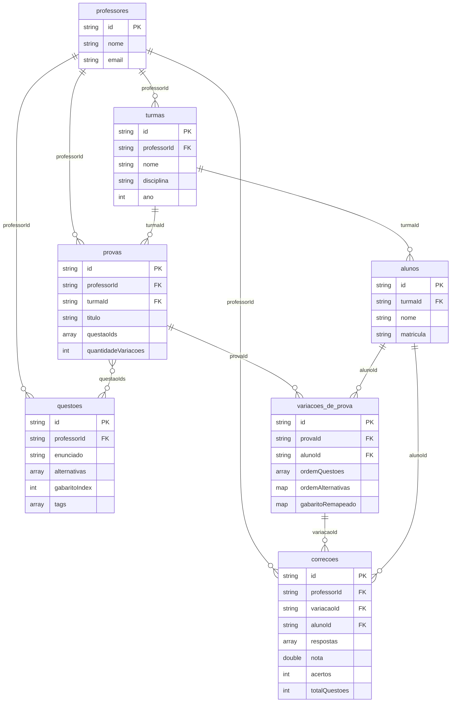

# Banco de Dados — meu_app

Realtime Database (Firebase). Nós derivados dos models em `lib/shared/models/`.

Auth: Firebase Auth. Nó `professores/{uid}` guarda perfil; senha **não** é persistida no RTDB.

## Diagrama ER

## Coleções

### `professores`

| Campo | Tipo | Descrição |
|-------|------|-----------|
| `id` | string | Document ID |
| `nome` | string | Nome do professor |
| `email` | string | E-mail (login Firebase Auth) |

### `turmas`

| Campo | Tipo | Descrição |
|-------|------|-----------|
| `id` | string | Document ID |
| `professorId` | string | FK → `professores.id` |
| `nome` | string | Ex.: "3º Ano A" |
| `disciplina` | string | Ex.: "Matemática" |
| `ano` | int | Ano letivo |

### `alunos`

| Campo | Tipo | Descrição |
|-------|------|-----------|
| `id` | string | Document ID |
| `turmaId` | string | FK → `turmas.id` |
| `nome` | string | Nome do aluno |
| `matricula` | string | Matrícula |

### `questoes`

| Campo | Tipo | Descrição |
|-------|------|-----------|
| `id` | string | Key |
| `professorId` | string | FK → `professores.id` (Auth uid) |
| `enunciado` | string | Texto da questão |
| `alternativas` | array\<string\> | Sempre 4 itens (A–D) |
| `gabaritoIndex` | int | Índice 0–3 da alternativa correta |
| `tags` | array\<string\> | Tags (ex.: "matemática") |

### `provas`

| Campo | Tipo | Descrição |
|-------|------|-----------|
| `id` | string | Key |
| `professorId` | string | FK → `professores.id` (Auth uid) |
| `turmaId` | string | FK → `turmas.id` (alunos / variações) |
| `titulo` | string | Título da prova |
| `questaoIds` | array\<string\> | FKs → `questoes.id` |
| `quantidadeVariacoes` | int | Quantidade de variações a gerar |

### `variacoes_de_prova`

Versão embaralhada de uma prova vinculada a um aluno.

| Campo | Tipo | Descrição |
|-------|------|-----------|
| `id` | string | Document ID |
| `provaId` | string | FK → `provas.id` |
| `alunoId` | string | FK → `alunos.id` |
| `ordemQuestoes` | array\<string\> | IDs das questões nesta ordem |
| `ordemAlternativas` | map\<string, array\<int\>\> | Por `questaoId`: permutação dos índices 0–3 |
| `gabaritoRemapeado` | map\<string, int\> | Índice correto pós-embaralhamento, por questão |

### `correcoes`

| Campo | Tipo | Descrição |
|-------|------|-----------|
| `id` | string | Document ID |
| `professorId` | string | FK → `professores.id` (Auth uid; filtro de Resultados) |
| `variacaoId` | string | FK → `variacoes_de_prova.id` |
| `alunoId` | string | FK → `alunos.id` |
| `respostas` | array\<int\> | Alternativa marcada (0–3) por posição na variação |
| `nota` | double | Nota calculada |
| `acertos` | int | Quantidade de acertos |
| `totalQuestoes` | int | Total de questões na variação |

## Restrições

- `questoes.alternativas`: sempre 4 elementos
- `questoes.gabaritoIndex`: 0–3
- `correcoes.respostas[i]`: 0–3
- Senha do professor: só Firebase Auth, nunca no RTDB

## Fonte

Models: `lib/shared/models/`. Seed: [seed/realtime-database-seed.json](seed/realtime-database-seed.json).
