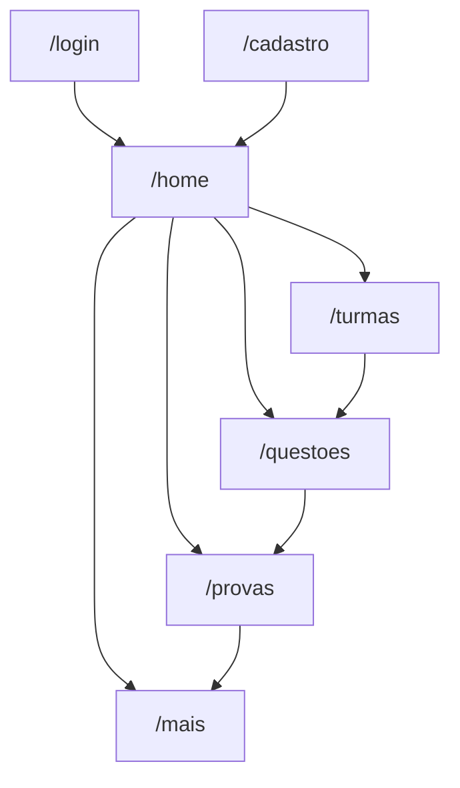
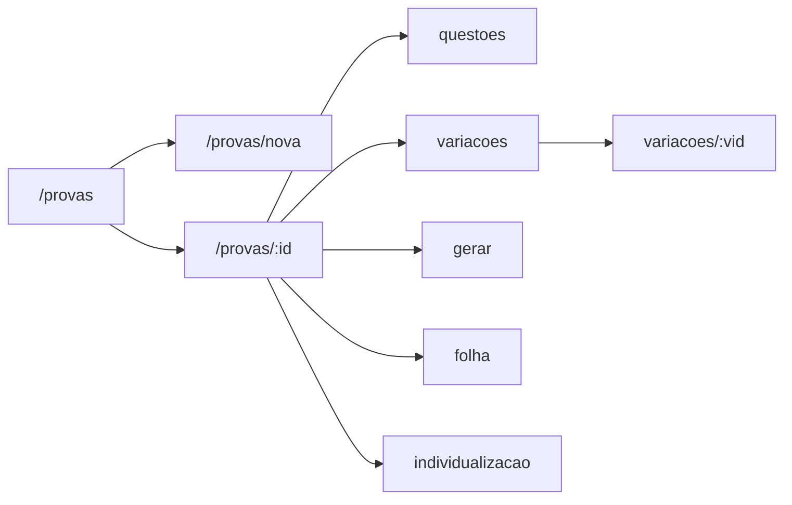

# Fluxos de usuário — telas atuais (N2)

Fonte das rotas: [`lib/core/router/app_router.dart`](../lib/core/router/app_router.dart).  
Dados: **Firebase Auth** + **Realtime Database** (`*RtdbRepository`).

Shell (após login): NavigationBar com **Início | Turmas | Questões | Provas | Mais**.

Não autenticado → redireciona para `/login`. Autenticado em login/cadastro → `/home`.

---

## 1. Auth

**Objetivo:** entrar ou criar conta de professor.

| Rota | Tela |
|------|------|
| `/login` | `LoginPage` |
| `/cadastro` | `CadastroPage` |

**Fluxo**

1. Abrir app → `/login`
2. Informar e-mail/senha → Auth `login` → perfil `professores/{uid}` → `/home`
3. Ou **Cadastro** → `/cadastro` → Auth `register` + grava perfil → login → `/home`
4. Em `/home`, logout → Auth `logout` → `/login`

**Dados:** Firebase Auth; nó RTDB `professores/{uid}` (nome, e-mail).

---

## 2. Início (Home)

**Objetivo:** atalhos do fluxo principal.

| Rota | Tela |
|------|------|
| `/home` | `DashboardPage` |

**Ações**

- Cards → `/turmas`, `/questoes`, `/provas`, `/mais/correcao`, `/mais/resultados`
- Logout

**Dados:** só sessão (`authSessionProvider`).

---

## 3. Turmas e alunos

**Objetivo:** CRUD de turmas e alunos; importar CSV.

| Rota | Tela |
|------|------|
| `/turmas` | `TurmasListPage` |
| `/turmas/nova` | `TurmaFormPage` (criar) |
| `/turmas/:turmaId` | `TurmaDetailPage` |
| `/turmas/:turmaId/editar` | `TurmaFormPage` (editar) |
| `/turmas/:turmaId/alunos/novo` | `AlunoFormPage` |
| `/turmas/:turmaId/alunos/:alunoId/editar` | `AlunoFormPage` |
| `/turmas/:turmaId/importar` | `ImportarAlunosPage` |

**Fluxo típico**

1. Tab **Turmas** → lista (`listByProfessor`)
2. FAB **Nova turma** → form → create → volta à lista
3. Abrir turma → alunos da turma; editar/excluir turma; FAB aluno; ícone upload → CSV
4. **Importar:** `file_picker` → `CsvAlunosParser` (prévia/validação) → create alunos → RTDB
5. Aluno: criar/editar/excluir

**Dados:** `turmas` (`professorId`), `alunos` (`turmaId`).

---

## 4. Questões

**Objetivo:** banco de questões (CRUD + busca).

| Rota | Tela |
|------|------|
| `/questoes` | `QuestoesListPage` |
| `/questoes/nova` | `QuestaoFormPage` |
| `/questoes/:questaoId/editar` | `QuestaoFormPage` |

**Fluxo**

1. Tab **Questões** → listar (filtro/busca)
2. Nova → enunciado, 4 alternativas, gabarito, tags → create
3. Editar / excluir

**Dados:** `questoes` (`professorId`, `gabaritoIndex` 0–3).

---

## 5. Provas, variações e geração (PDF / QR)

**Objetivo:** montar prova ligada a uma turma, embaralhar por aluno, imprimir PDF com QR.

| Rota | Tela |
|------|------|
| `/provas` | `ProvasListPage` |
| `/provas/nova` | `ProvaFormPage` |
| `/provas/:provaId` | `ProvaDetailPage` |
| `/provas/:provaId/questoes` | `ProvaQuestoesPage` |
| `/provas/:provaId/variacoes` | `ProvaVariacoesPage` |
| `/provas/:provaId/variacoes/:variacaoId` | `VariacaoPreviewPage` |
| `/provas/:provaId/gerar` | `GerarProvaPage` |
| `/provas/:provaId/folha` | `FolhaRespostasPage` |
| `/provas/:provaId/individualizacao` | `IndividualizacaoPage` |

### 5.1 Criar e montar

1. **Nova prova** → título + **turma** + questões → create (`turmaId`, `questaoIds`)
2. **Detalhe** → ver/trocar turma; atalhos montagem/saída
3. **Questões e ordem** → ordenar `questaoIds` → update

### 5.2 Variações / embaralhamento

1. Escolher turma (grava `prova.turmaId`)
2. Switches: embaralhar questões / alternativas
3. Checklist de alunos → **Gerar selecionados** ou **Gerar turma inteira**
4. Cada aluno → `gerarVariacao` (ordem + `gabaritoRemapeado`) → lista → preview

### 5.3 PDF e QR

| Tela | Ação | QR |
|------|------|-----|
| Gerar | PDF prova + folha **geral** | `CPROVA\|v1\|p=<provaId>` |
| Folha | PDF só folha geral | idem |
| Individualização | PDF **1 aluno** (prova+folha) | `p` + `v` + `a` |
| Individualização | PDF **turma inteira** | QR individual por cópia |

`PdfAcoes`: imprimir/salvar ou compartilhar (`printing`).

**Dados:** `provas`, `variacoes_de_prova`, questões do banco.

---

## 6. Mais — correção, resultados, estatísticas

| Rota | Tela |
|------|------|
| `/mais` | `MaisMenuPage` |
| `/mais/correcao` | `CorrigirProvaPage` |
| `/mais/correcao/resultado/:correcaoId` | `CorrecaoResultadoPage` |
| `/mais/resultados` | `ResultadosPage` |
| `/mais/resultados/:alunoId` | `NotaAlunoPage` |
| `/mais/estatisticas` | `EstatisticasPage` |

### 6.1 Corrigir prova

1. Câmera (ou digitar código) lê QR individual
2. App identifica prova, variação, aluno
3. Professor marca A–D por questão (ordem da variação)
4. `corrigir` → nota vs `gabaritoRemapeado` → RTDB (`professorId`) → tela de resultado

OMR da folha = N3 (ainda não).

### 6.2 Resultados

1. Lista correções do professor (só com aluno existente)
2. Toque → nota do aluno
3. **Simular resultado:** aluno real **sem** correção + prova da turma → respostas aleatórias → `corrigir` (demo)

### 6.3 Estatísticas

Gráfico / métricas a partir de `correcoes.listAll()` do professor.

**Dados:** `correcoes` filtradas por `professorId`.

---

## Mapa rápido rota → função

| Área | Função |
|------|--------|
| Auth | Login / cadastro professor |
| Home | Atalhos + logout |
| Turmas | CRUD turma/aluno + CSV |
| Questões | CRUD banco |
| Provas | Montagem, turma, variações, PDF/QR |
| Mais | Correção pós-QR, resultados, estatísticas |
